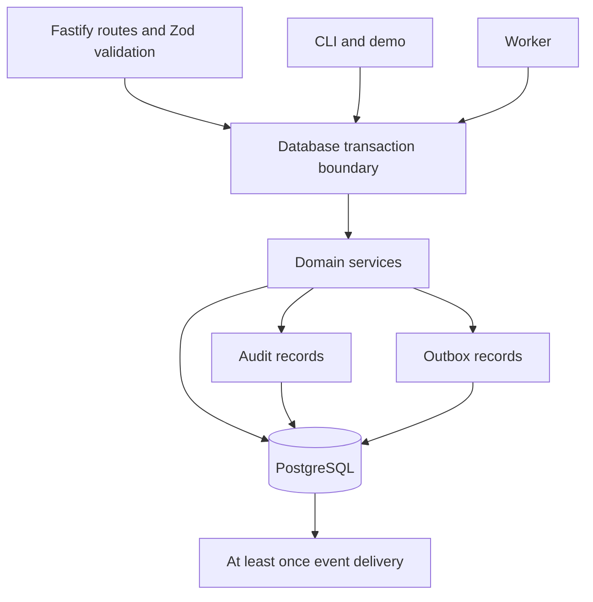

# Architecture

## Boundaries

The application is a modular monolith with a separate worker process and one PostgreSQL
database. HTTP handlers validate request shapes and delegate use cases. Services enforce
business rules and issue parameterized SQL. Domain types describe returned records; value
helpers validate integral quantities and perform exact proportional cost calculations.

`Database.transaction()` wraps each use case, acquiring a PostgreSQL transaction advisory
lock. This lock serializes all cooperating application instances. Time is captured after
lock acquisition. A worker waiting for a lock therefore cannot approve a payment using
an old pre-wait timestamp. Tests may inject a timestamp for deterministic deadline checks.

The lock is intentionally coarse for this single-business baseline. Reads also use the
same boundary. It is a throughput limitation and an explicit future design decision.

## Functional module map

| Module under `src/services/` | Responsibility                                            |
| ---------------------------- | --------------------------------------------------------- |
| `suppliers`                  | Supplier identity and origin                              |
| `customers`                  | Customer contact details and sales channel                |
| `warehouses`                 | Stock locations and fulfillment priority                  |
| `catalog`                    | Product kind, pack weight and price                       |
| `procurement`                | Purchase orders and expected acquisition costs            |
| `receiving`                  | Partial receipts and cumulative cost allocation           |
| `inventory`                  | Lot creation, stock consumption and availability          |
| `ledger`                     | Physical stock and cost movements                         |
| `quality`                    | Approval, quarantine and inspection notes                 |
| `adjustments`                | Recorded waste of unreserved usable stock                 |
| `production`                 | Shared conversion, lineage and output costing             |
| `roasting`                   | Green-to-roasted conversion and measured yield            |
| `recipes`                    | Immutable blend composition in basis points               |
| `blending`                   | Multi-lot composition and exact proportions               |
| `packaging`                  | Bulk coffee and bag kits to sellable units                |
| `allocation`                 | Warehouse selection and earliest-expiry-first planning    |
| `orders`                     | Captured prices, atomic reservations and order queries    |
| `reservations`               | Release and expiration of unpaid reservations             |
| `payments`                   | Simulated, deduplicated payment acceptance                |
| `cancellation`               | Reservation release and simulated paid-order refund       |
| `shipping`                   | Shipment creation, stock deduction and cost capture       |
| `returns`                    | Inspected returns and bounded restocking                  |
| `idempotency`                | Request fingerprints and resource replay                  |
| `traceability`               | Recursive ancestry, descendants and shipment destinations |
| `reporting`                  | Operational inventory, acquisition and margin views       |
| `audit`                      | Business-action history                                   |
| `events`                     | Transactional domain-event recording                      |
| `outbox`                     | At least once publication and retry diagnostics           |
| `jobs`                       | Expiry and event-delivery orchestration                   |

## State transitions

An order starts `reserved`, becomes `paid`, then becomes `shipped`. An unpaid order can
become `expired`. Reserved, paid and expired orders can become `cancelled`; only reserved
and paid cancellations release active stock reservations. A paid cancellation marks a
simulated refund. A shipped order uses the separate returns workflow.

Allocation history remains attached to cancelled and expired orders for auditing, but
only reserved/paid orders own active reservations. Inventory quantities change at shipment,
not payment. Prices and shipment costs are captured rather than recalculated from current
catalog or inventory values.

## Cost and lineage

A lot holds its remaining acquisition/production cost. Consumption takes a proportional
integer share; full consumption takes the remaining cents. Production places all consumed
cost in the output, including roast yield loss and bag-kit cost. Multiple partial receipts
use cumulative allocation differences to prevent rounding cents being lost.

Lineage edges carry input quantity in the parent's unit. They do not mix grams and bags.
Production records separately hold coffee input/output grams. Trace queries walk each
direction independently, avoiding unrelated sibling branches in recall results.

## Outbox behavior

Domain changes and events commit together. A job publishes pending events and records
attempts. If publication succeeds but the process crashes before commit, the event is
published again with the same ID. The supplied publisher writes JSON to stdout. A real
integration must deduplicate and provide bounded network timeouts. Delivery currently
holds the coarse transaction lock, so slow publishers delay other operations.
